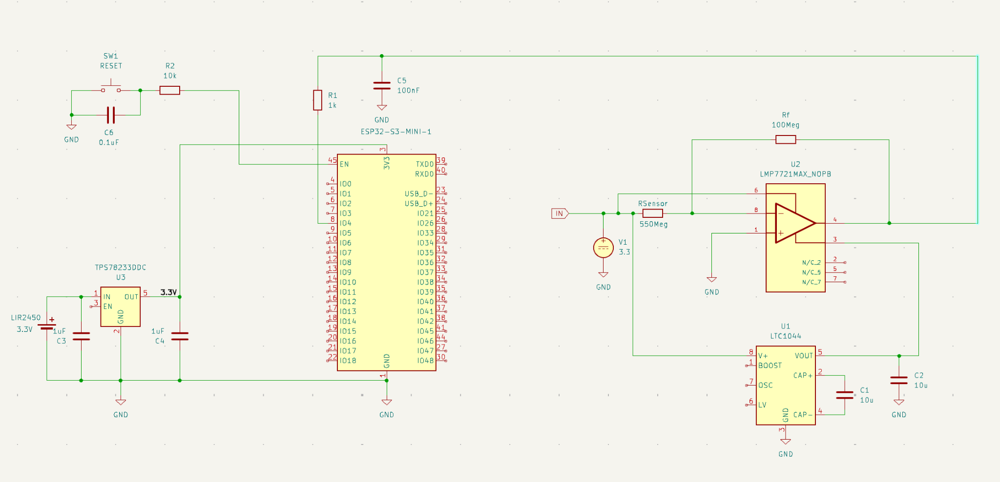
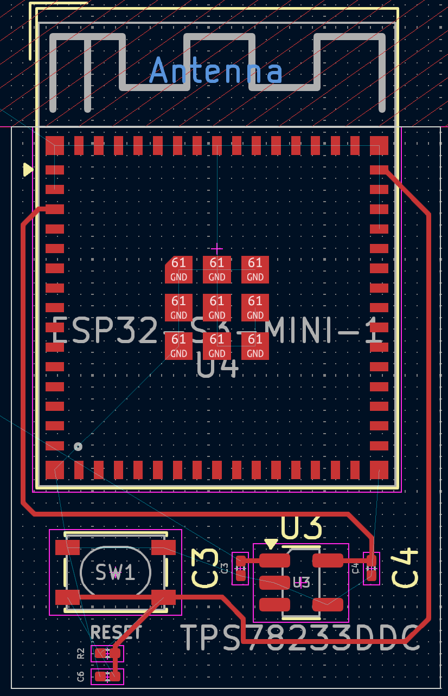

# SENS-CO – Wearable Gas Sensor Acquisition Node

Design, simulation, and PCB implementation of an embedded wireless acquisition node for a high-impedance WS₂ gas sensor.

This repository presents the engineering work completed for the SENS-CO project: high-impedance analog acquisition, power management, ESP32-S3 integration, simulation, and PCB implementation.

## System Overview



The final architecture combines:

- **WS₂ resistive gas sensor** — high-impedance sensing element
- **LMP7721** — precision transimpedance amplifier for very small sensor currents
- **100 MΩ feedback resistor** — current-to-voltage conversion
- **LTC1044** — switched-capacitor voltage inverter for the analog negative rail
- **TPS78233** — 3.3 V low-dropout regulator
- **ESP32-S3-MINI-1** — ADC acquisition, processing, and wireless connectivity
- **LIR2450** — rechargeable battery source

## Engineering Work

The project includes:

- High-impedance analog front-end design
- ADA4530-1 vs. LMP7721 simulation comparison
- Sensor resistance and conductance sweeps
- LTC1044 negative-supply integration
- ESP32-S3-MINI-1 and 3.3 V power architecture
- KiCad schematic capture and PCB design
- High-impedance layout techniques, including short sensitive traces and guarded routing
- Separation of sensitive analog circuitry from switching and RF sections

## Analog Front-End Simulation

The ADA4530-1 and LMP7721 were evaluated using transient and parametric simulations.

### Transient response

| ADA4530-1 | LMP7721 |
|---|---|
|  |  |

### Output vs. sensor resistance

| ADA4530-1 | LMP7721 |
|---|---|
|  |  |

### Output vs. sensor conductance

| ADA4530-1 | LMP7721 |
|---|---|
|  |  |

The **LMP7721** was retained for the final hardware implementation.

## PCB Implementation

The PCB work is split into the sensitive analog front-end and the ESP32/power section in the supplied design history.



The repository contains the actual KiCad board files for both sections under `hardware/kicad/pcb/` and the final combined system schematic under `hardware/kicad/schematic/`.

## Repository Structure

```text
.
├── README.md
├── LICENSE
├── .gitignore
├── docs/
│   └── SENS-CO_Project_Report.pdf
├── hardware/
│   ├── README.md
│   └── kicad/
│       ├── schematic/
│       │   └── SENS-CO_final_system.kicad_sch
│       ├── pcb/
│       │   ├── SENS-CO_analog_frontend.kicad_pcb
│       │   └── SENS-CO_esp32_power.kicad_pcb
│       └── libraries/
│           └── SENS-CO_custom_symbols.kicad_sym
├── simulations/
│   ├── README.md
│   ├── data/
│   │   ├── LMP7721_resistance_sweep.csv
│   │   └── LMP7721_resistance_sweep.wbk
│   └── results/
│       ├── transient/
│       ├── resistance-sweep/
│       └── conductance-sweep/
└── images/
    ├── system_schematic.png
    └── esp32_power_pcb.png
```

## Documentation

The complete technical report is available at:

[`docs/SENS-CO_Project_Report.pdf`](docs/SENS-CO_Project_Report.pdf)

## Tools and Technologies

- KiCad
- SPICE / ngspice simulation
- MATLAB data visualization
- ESP32-S3
- Precision analog / transimpedance amplifier design
- High-impedance PCB layout
- Embedded power management

## Notes

This repository intentionally excludes duplicate files, KiCad lock files, local preference files, caches, backups, and earlier component alternatives that are not part of the final report architecture.

Third-party vendor SPICE models are also not redistributed here because their redistribution terms were not established from the supplied project files.

## Author

**Souhaib Hajjaj**  
ISMIN – Mines Saint-Étienne
