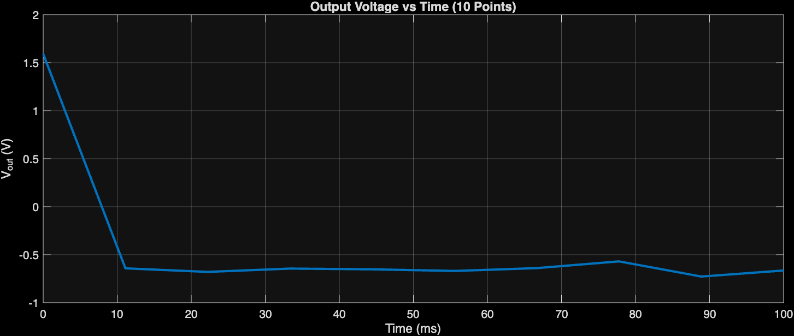
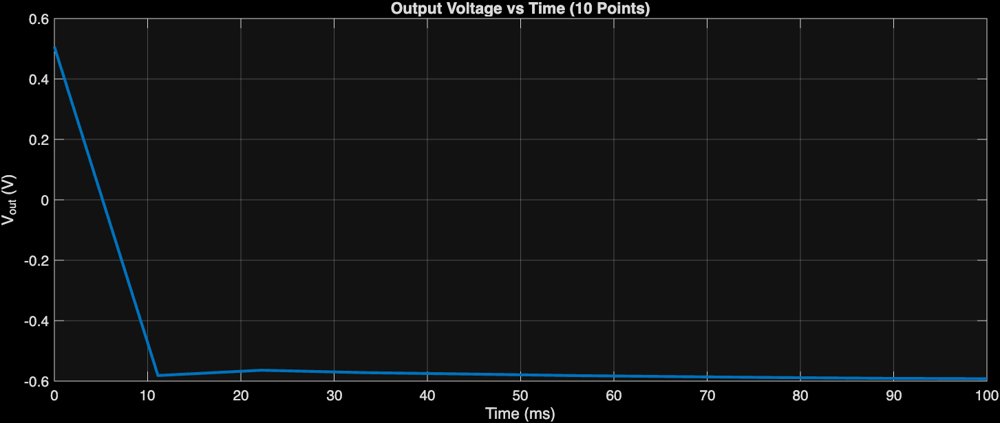
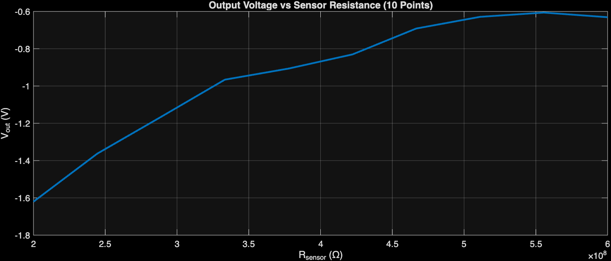
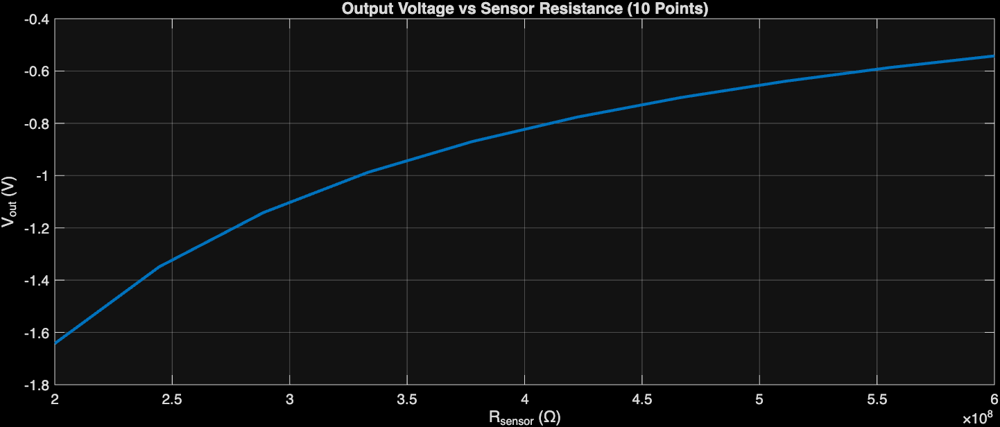
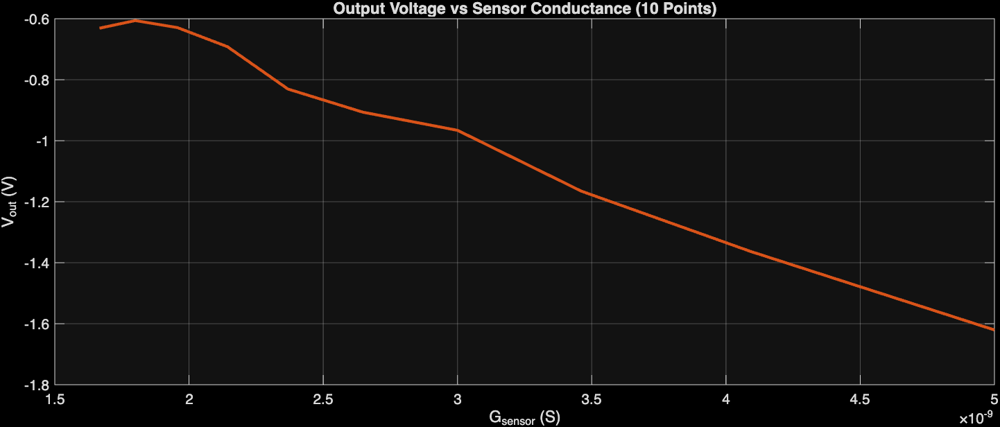
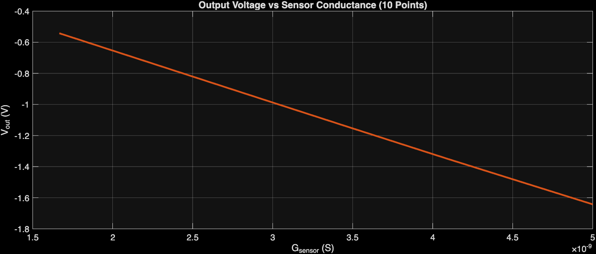

# Analog Front-End Simulations

This directory contains the simulation results used to study the high-impedance analog front-end described in the project report.

Two precision amplifiers were evaluated:

- ADA4530-1
- LMP7721

The comparison includes transient response, output voltage versus sensor resistance, and output voltage versus sensor conductance.

The final hardware design uses the LMP7721 with a 100 MΩ feedback resistor. The sensor is represented by a resistance in the hundreds-of-megaohms range.

## Results

### Transient response

| ADA4530-1 | LMP7721 |
|---|---|
|  |  |

### Sensor resistance sweep

| ADA4530-1 | LMP7721 |
|---|---|
|  |  |

### Sensor conductance sweep

| ADA4530-1 | LMP7721 |
|---|---|
|  |  |

## Reproducibility note

`data/LMP7721_resistance_sweep.csv` contains the exported DC sweep values and `data/LMP7721_resistance_sweep.wbk` contains the KiCad simulator workbook settings that were provided with the project files.

Vendor SPICE model files are not redistributed in this public-repository package because their redistribution terms were not established from the supplied files.
